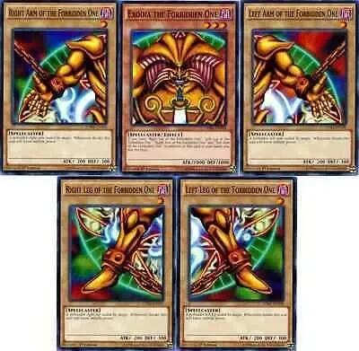

# Análise Combinatória e Probabilidade

## Overview
This section is dedicated to an introductory study of combinatorics, probability, and statistics.
My goal is to explore some concepts from these areas through examples and simulations that only programming
can provide.

### Opening Hand Exodia
---

Simulates Yu-Gi-Oh! games where the player starts the game with all five pieces of Exodia in their hand.
We also conduct some analyses regarding card appearances.

    

### Coin Flip
---
Simulates coin tosses.